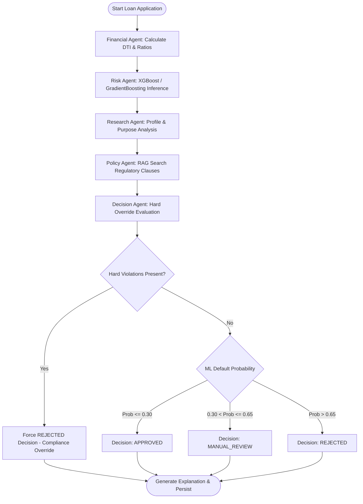
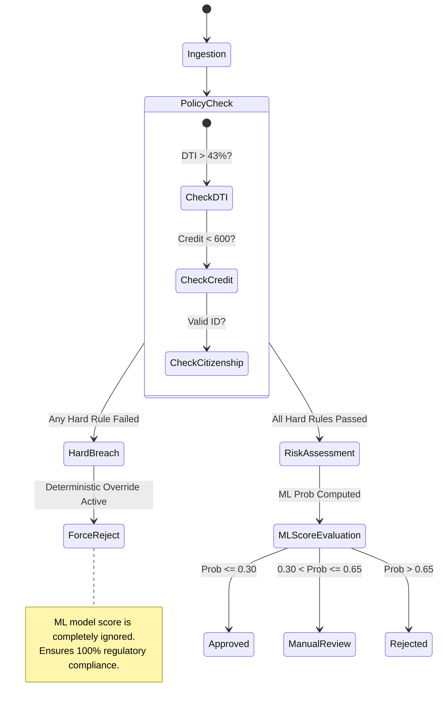
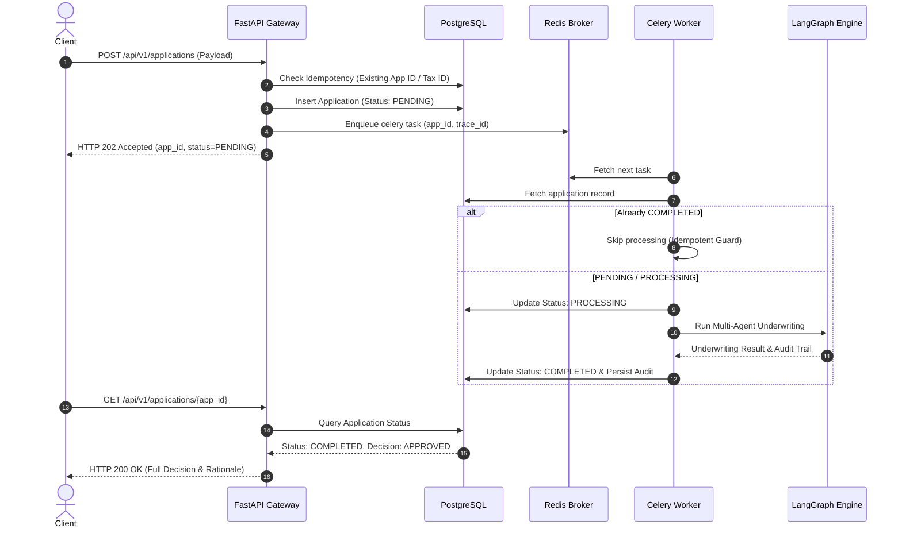
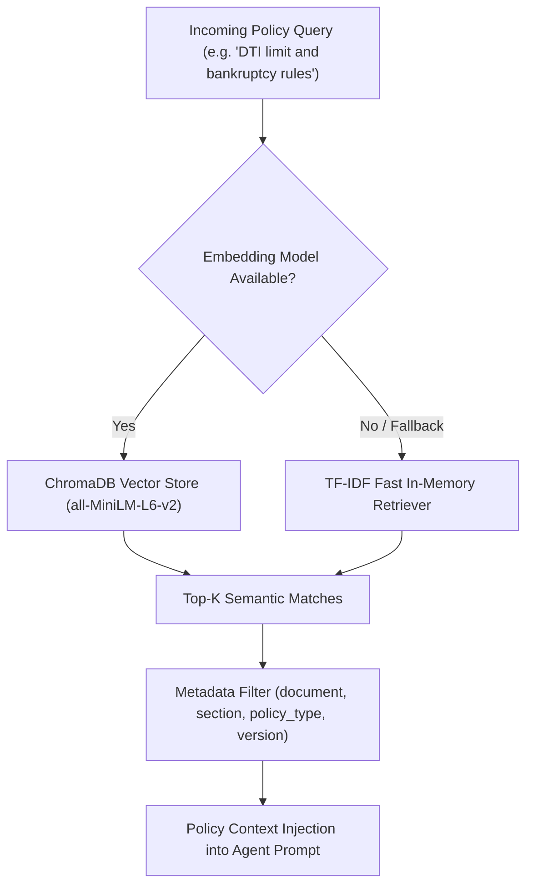
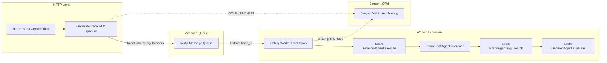
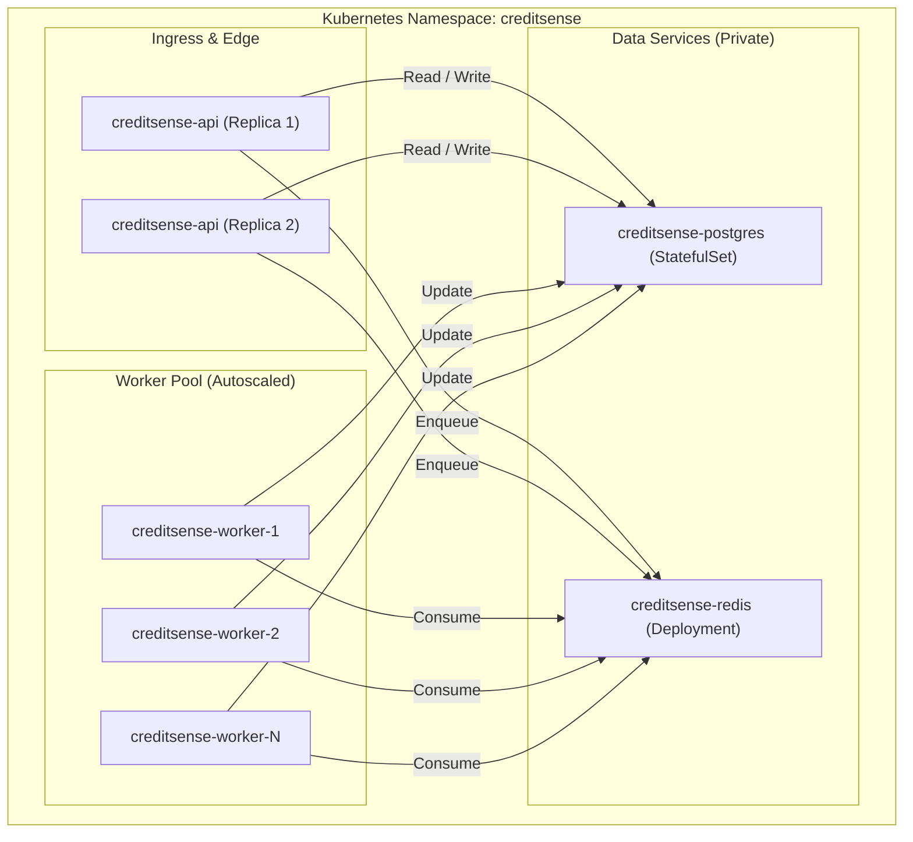
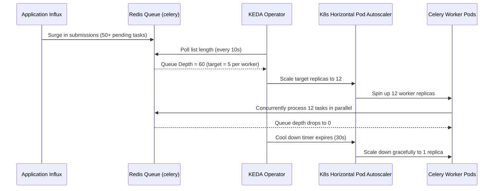
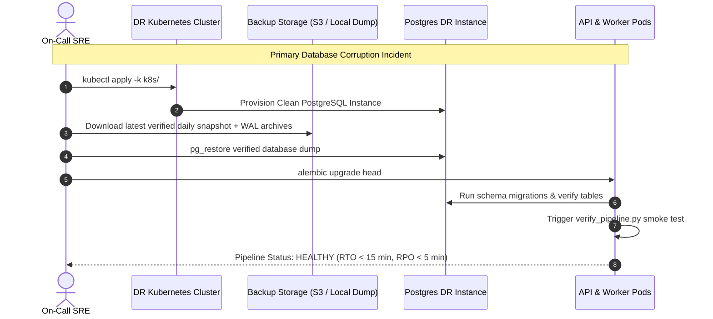

# CreditSense - 10 Production Architecture & Flow Diagrams

This document contains 10 Mermaid architectural diagrams representing every tier and subsystem of the CreditSense platform.

---

## 1. End-to-End Cloud-Native Architecture

```mermaid
graph TD
    Client["Client / Underwriter UI"] -->|HTTP REST| Ingress["Ingress / API Gateway (FastAPI)"]
    Ingress -->|Record Metrics| Prom["Prometheus (9090)"]
    Prom -->|Visualize| Graf["Grafana Dashboard (3000)"]
    Ingress -->|Export Traces| Jaeger["Jaeger Distributed Tracing (4317)"]
    
    Ingress -->|Enqueue Task (202 Accepted)| Redis[("Redis 7 (Broker & Result Backend)")]
    Ingress -->|Read / Write Status| PG[("PostgreSQL Database (5432)")]
    
    Redis -->|Consume Task| CeleryWorker["Celery Asynchronous Workers"]
    CeleryWorker -->|Execute Pipeline| LangGraph["LangGraph Multi-Agent Engine"]
    
    subgraph "Multi-Agent Underwriting Engine"
        LangGraph --> FA["Financial Agent"]
        LangGraph --> RA["Risk Agent (ML Model)"]
        LangGraph --> ResA["Research Agent"]
        LangGraph --> PolA["Policy Agent (RAG)"]
        LangGraph --> DecA["Decision Agent (Deterministic Override)"]
    end
    
    PolA -->|Vector Search| Chroma[("ChromaDB / TF-IDF Policy Store")]
    DecA -->|Persist Decision & Audit Trail| PG
```

---

## 2. LangGraph Multi-Agent Underwriting Workflow



---

## 3. Deterministic Compliance Override State Machine



---

## 4. Asynchronous Task Processing & Idempotency Flow



---

## 5. RAG Dual-Engine Hybrid Retrieval Architecture



---

## 6. Distributed Tracing & Trace Context Propagation



---

## 7. Observability & Multi-Window Burn-Rate Alerting

```mermaid
graph TD
    AppMetrics["FastAPI & Worker Metrics"] -->|Scrape /metrics (15s)| Prometheus["Prometheus Server"]
    
    Prometheus -->|Evaluate Alert Rules| Engine{"Alert Evaluation"}
    
    Engine -->|Burn Rate > 14.4x (1h)| PageAlert["Sev-1 Page: High Error Budget Burn"]
    Engine -->|Burn Rate > 6.0x (6h)| WarnAlert["Sev-2 Warning: Moderate Burn"]
    Engine -->|Queue Depth > 50| QueueAlert["Sev-2 Warning: Redis Queue Spike"]
    Engine -->|p99 Latency > 5s| LatencyAlert["Sev-2 Warning: Pipeline Latency SLO Breach"]
    
    Prometheus -->|Data Source| Grafana["Grafana Dashboards"]
```

---

## 8. Kubernetes Pod Topology & Network Policy



---

## 9. KEDA Event-Driven Autoscaling Architecture



---

## 10. Disaster Recovery & Failover Sequence


